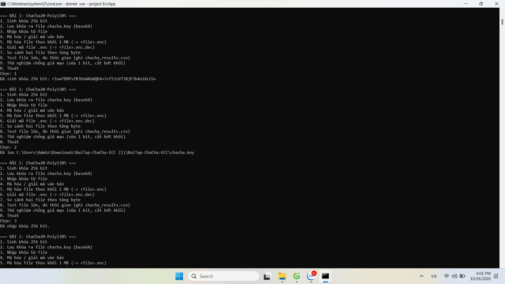
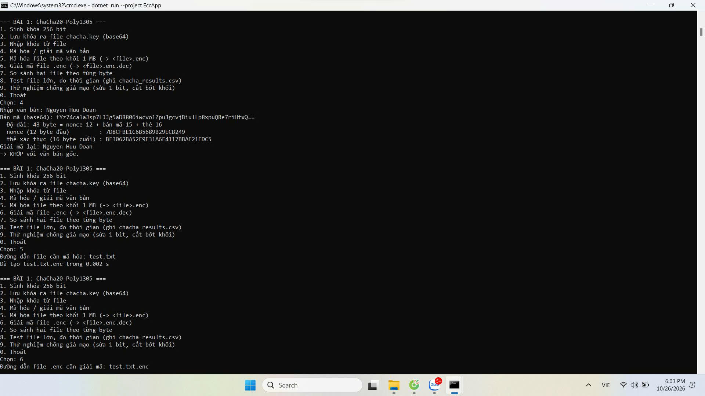
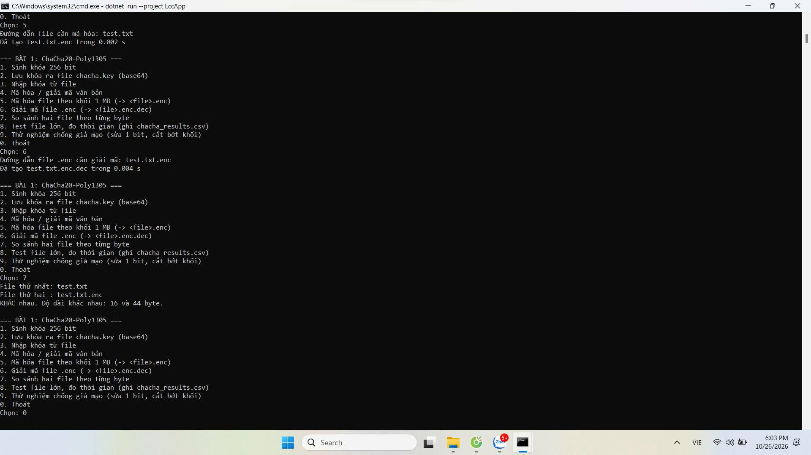
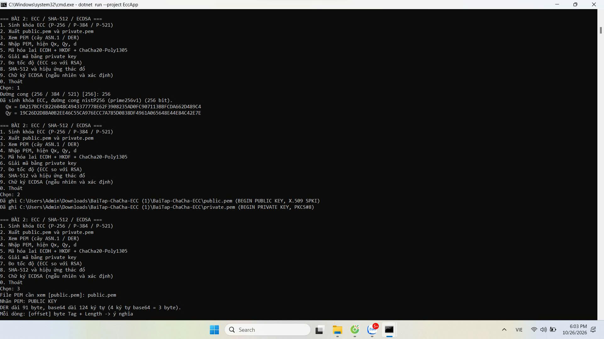
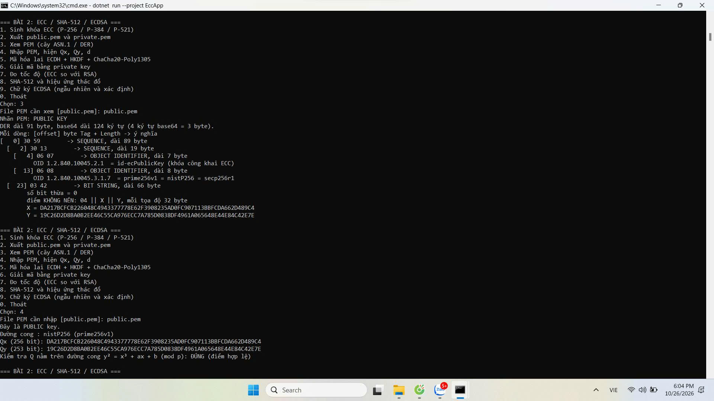
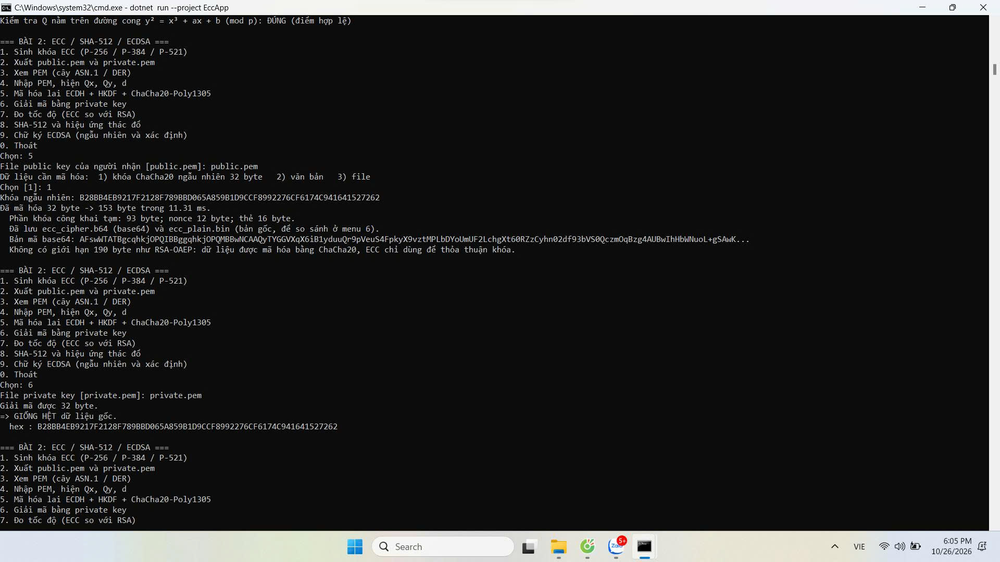
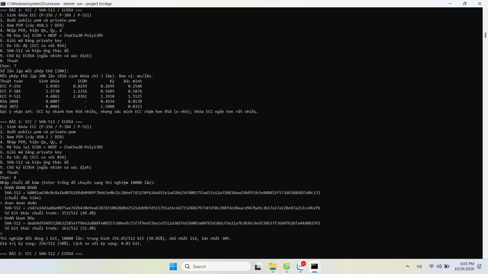
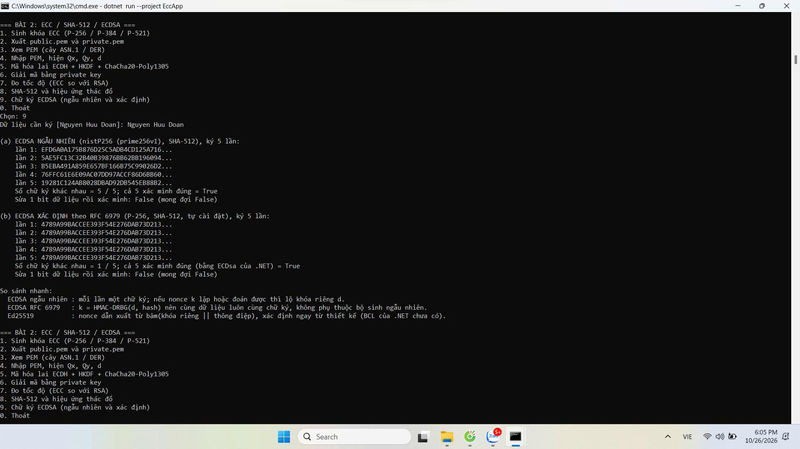

# Bài tập An toàn và Bảo mật thông tin: ChaCha20-Poly1305, ECC, SHA-512, ECDSA

Sinh viên: **Nguyen Huu Doan** – lớp K59KMT – Trường ĐH Kỹ thuật Công nghiệp Thái Nguyên.

Bài tập tương tự AES - RSA - SHA-256 - chữ ký số, đã đổi từ khóa:
AES-CBC → ChaCha20-Poly1305, RSA → ECC (ECDH, ECDSA), SHA-256 → SHA-512,
chữ ký ngẫu nhiên → chữ ký xác định (RFC 6979).

| Thư mục | Nội dung |
|---|---|
| [`docs/DE_BAI.md`](docs/DE_BAI.md) | Đề bài đầy đủ |
| [`docs/BAO_CAO.md`](docs/BAO_CAO.md) | Báo cáo: số liệu từ ảnh, trả lời câu hỏi phân tích |
| [`docs/images`](docs/images) | Ảnh chụp màn hình minh chứng (đặt tên theo menu) |
| [`ChaChaApp`](ChaChaApp) | Bài 1: ứng dụng console C# (menu 1 đến 9) |
| [`EccApp`](EccApp) | Bài 2: ứng dụng console C# (menu 1 đến 9) |
| [`reference`](reference) | Script Python đối chiếu và kết quả tham chiếu |
| [`test.txt`](test.txt) | File mẫu nhỏ dùng cho menu 5, 6, 7 của Bài 1 |

## Yêu cầu và cách chạy

.NET SDK 8 trở lên (đã đặt `RollForward=Major`). `ChaCha20Poly1305.IsSupported` phải là `true`.

```bash
dotnet run --project ChaChaApp   # Bài 1
dotnet run --project EccApp      # Bài 2
```

Gõ số menu rồi Enter. File sinh ra khi chạy (`chacha.key`, `public.pem`, `private.pem`, `ecc_cipher.b64`, `*.enc`, ...)
nằm ở thư mục đang đứng và đã được `.gitignore` loại trừ. **Không đưa khóa bí mật lên GitHub.**

> Cấu hình máy đo: Windows, chạy bằng `cmd.exe` (ảnh minh chứng ghi ngày 26/10/2026).
> CPU: `<điền>` · .NET: `<điền kết quả dotnet --version>`.

---

## Kết quả thực nghiệm (số liệu lấy từ ảnh minh chứng)

Toàn bộ số liệu dưới đây đọc từ ảnh chụp màn hình khi chạy app C# trên máy của sinh viên.
Tiêu đề cửa sổ cmd trong ảnh Bài 1 còn ghi lệnh `--project EccApp` (lệnh cũ của cửa sổ); nội dung hiển thị đúng là menu Bài 1.

### Bài 1 – ChaCha20-Poly1305

#### Menu 1, 2, 3: sinh khóa, lưu khóa, nhập khóa


- Menu 1: sinh khóa 256 bit (32 byte), in dạng base64.
- Menu 2: lưu vào `chacha.key`.
- Menu 3: nhập lại khóa, app báo «Đã nhập khóa 256 bit».

#### Menu 4, 5: mã hóa văn bản và mã hóa file


| Mục | Giá trị trong ảnh |
|---|---|
| Văn bản nhập | `Nguyen Huu Doan` (15 byte) |
| Độ dài đầu ra | **43 byte** = nonce 12 + bản mã 15 + thẻ 16 |
| Nonce (12 byte đầu) | `7D8CFBE1C6B5689B29ECB249` |
| Thẻ xác thực (16 byte cuối) | `BE3062BA52E9F31A6E4117BBAE21EDC5` |
| Giải mã lại | `Nguyen Huu Doan` → **KHỚP** với văn bản gốc |
| Menu 5: `test.txt` → `test.txt.enc` | **0.002 s** |

#### Menu 6, 7: giải mã file và so sánh byte


| Mục | Giá trị trong ảnh |
|---|---|
| Menu 6: `test.txt.enc` → `test.txt.enc.dec` | **0.004 s** |
| Menu 7: `test.txt` so với `test.txt.enc` | KHÁC nhau, độ dài **16** và **44** byte |

44 byte = 4 (`CCP1`) + 4 (tiền tố nonce) + 4 (độ dài khối) + 16 (bản mã) + 16 (thẻ), đúng với định dạng file `.enc`.
File `test.txt.enc.dec` sinh ra đã được kiểm tra bằng `cmp`: **giống hệt** `test.txt` từng byte.

> Chưa có ảnh: Bài 1 **menu 8** (bảng đo 100 MB, 1 GB, 3 GB) và **menu 9** (chống giả mạo). Cần chạy và chụp bổ sung, đặt vào `docs/images/` rồi điền bảng ở `docs/BAO_CAO.md`.

### Bài 2 – ECC / SHA-512 / ECDSA

#### Menu 1, 2: sinh khóa P-256 và xuất PEM


Đường cong **nistP256 (prime256v1)**, 256 bit.

- Qx = `DA217BCFCB226048C4943377778E62F3908235AD0FC907113BBFCDA662D489C4`
- Qy = `19C26D2D8BA0B2EE46C55CA976ECC7A785D0838DF4961A065648E44E84C42E7E`
- Xuất `public.pem` (X.509 SPKI) và `private.pem` (PKCS#8).

#### Menu 3, 4: xem cấu trúc ASN.1/DER và nhập PEM


DER của `public.pem` dài **91 byte**, base64 dài **124 ký tự**.

| Offset | Byte | Ý nghĩa |
|---:|---|---|
| 0 | `30 59` | SEQUENCE, dài 89 byte |
| 2 | `30 13` | SEQUENCE, dài 19 byte |
| 4 | `06 07` | OID 1.2.840.10045.2.1 = id-ecPublicKey |
| 13 | `06 08` | OID 1.2.840.10045.3.1.7 = prime256v1 = nistP256 |
| 23 | `03 42` | BIT STRING, dài 66 byte, số bit thừa 0 |
| 26 (suy ra) | `04 ‖ X ‖ Y` | Điểm không nén, mỗi tọa độ 32 byte (23 + 2 + 66 = 91) |

Menu 4: Qx **256 bit**, Qy **253 bit** (do Qy bắt đầu bằng `0x19`, 3 bit đầu bằng 0); kiểm tra y² = x³ + ax + b (mod p): **ĐÚNG (điểm hợp lệ)**.

#### Menu 5, 6: mã hóa lai ECDH + HKDF + ChaCha20-Poly1305


| Mục | Giá trị trong ảnh |
|---|---|
| Dữ liệu | khóa ChaCha20 ngẫu nhiên 32 byte |
| Bản mã | **153 byte** trong **11.31 ms** |
| Cấu thành | khóa công khai tạm 93 byte (2 byte độ dài + 91 byte SPKI) + nonce 12 + dữ liệu 32 + thẻ 16 |
| Menu 6 (giải mã bằng `private.pem`) | giải được 32 byte, **GIỐNG HỆT** dữ liệu gốc |

> Chưa có ảnh: mã hóa lai với văn bản 1 KB và file 5 MB (đề yêu cầu cả ba trường hợp).

#### Menu 7: đo tốc độ (lặp 200 lần, đơn vị ms/lần)


| Thuật toán | Sinh khóa | ECDH | Ký | Xác minh |
|---|---:|---:|---:|---:|
| ECC P-256 | 1.0303 | 0.8259 | 0.2699 | 0.2548 |
| ECC P-384 | 1.9730 | 1.2316 | 0.5605 | 0.5874 |
| ECC P-521 | 4.4861 | 2.0361 | 1.3910 | 1.5125 |
| RSA 2048 | ~~0.0007~~ (*) | – | 0.4934 | 0.0170 |
| RSA 3072 | ~~0.0001~~ (*) | – | 1.5808 | 0.0323 |

(*) Hai ô sinh khóa RSA **không hợp lệ**: `RSA.Create(bits)` của .NET sinh khóa lười nên lần đo chưa sinh khóa thật.
Đã sửa trong `EccApp/Program.cs` (thêm `ExportParameters(false)` để ép sinh khóa). **Chạy lại menu 7 và thay hai số này bằng số mới.**

#### Menu 8: SHA-512 và hiệu ứng thác đổ
(cùng ảnh với menu 7 ở trên)

| Chuỗi nhập | SHA-512 (16 ký tự hex đầu) | Số bit khác chuỗi trước |
|---|---|---|
| `DOAN DOAN DOAN` | `b8091a630c0c8a1b` | – |
| `doan doan doAn` | `c647a14d3a86e807` | 253/512 (49.4%) |
| `DoAN Doan DOa` | `dede9df649552063` | 263/512 (51.4%) |

Thí nghiệm đổi đúng 1 bit, **10000 lần**: trung bình **256.03/512 bit (50.01%)**, nhỏ nhất **214**, lớn nhất **309**; lệch so với kỳ vọng 256 là **0.03 bit**.
Các giá trị băm và số bit khác (253, 263) đã được tính lại độc lập bằng Python và khớp với ảnh.

> Chưa có ảnh: dòng «nhập lại y hệt chuỗi trước → 0/512» trong mẫu bảng của đề.

#### Menu 9: chữ ký ECDSA ngẫu nhiên và xác định


Dữ liệu ký: `Nguyen Huu Doan`, khóa nistP256, SHA-512, ký 5 lần.

| | ECDSA ngẫu nhiên | ECDSA xác định (RFC 6979) |
|---|---|---|
| 5 chữ ký (16 hex đầu) | `EFD6A0A175B876D2`, `5AE5FC13C32B40B3`, `B5EBA491A859E657`, `76FFC61E6E09AC07`, `19281C124AB8028D` | cả 5 lần đều `4789A99BACCEE393` |
| Số chữ ký khác nhau | **5 / 5** | **1 / 5** |
| Xác minh cả 5 | True | True (bằng `ECDsa` của .NET) |
| Sửa 1 bit dữ liệu rồi xác minh | False (đúng kỳ vọng) | False (đúng kỳ vọng) |

---

## Chức năng từng bài

### Bài 1 – `ChaChaApp`

| Menu | Chức năng |
|---|---|
| 1, 2, 3 | Sinh khóa 256 bit, lưu `chacha.key` (base64), nhập khóa (kiểm tra đúng 32 byte) |
| 4 | Mã hóa văn bản: `nonce(12) ‖ bản mã ‖ thẻ(16)` in base64, giải mã lại để đối chiếu |
| 5, 6 | Mã hóa / giải mã file theo khối 1 MB (đọc từng khối nên RAM gần hằng số) |
| 7 | So sánh hai file theo byte, báo vị trí byte khác đầu tiên |
| 8 | Tạo file ngẫu nhiên (mặc định 100, 1000, 3000 MB), mã hóa, giải mã, so sánh, ghi `chacha_results.csv` |
| 9 | Chống giả mạo: sửa 1 bit, cắt bỏ khối cuối, hoán đổi khối: tất cả đều bị từ chối |

Định dạng file `.enc`: `"CCP1" ‖ tiền tố nonce 4 byte ‖ { độ dài(4) ‖ bản mã ‖ thẻ(16) }...`.
Nonce khối *i* = tiền tố ‖ *i* (64 bit). AAD = *i* ‖ cờ «khối cuối». Khi giải mã, dữ liệu ghi vào file tạm và chỉ đổi tên thành `.dec` nếu **mọi** khối xác thực đúng.

### Bài 2 – `EccApp`

| Menu | Chức năng |
|---|---|
| 1, 2 | Sinh khóa P-256/384/521, xuất `public.pem` (SPKI) và `private.pem` (PKCS#8) |
| 3 | Xem PEM: giải base64 → DER, in cây ASN.1 có offset, byte Tag/Length, OID, điểm `04 ‖ X ‖ Y` |
| 4 | Nhập PEM, hiện đường cong, Qx, Qy (và d nếu là private key), kiểm tra Q thuộc đường cong |
| 5, 6 | Mã hóa lai: khóa tạm ECDH → HKDF-SHA256 → ChaCha20-Poly1305; giải mã và so sánh với bản gốc |
| 7 | Đo sinh khóa / ECDH / ký / xác minh của ECC P-256/384/521 và so với RSA 2048/3072 |
| 8 | SHA-512, đếm bit khác giữa các lần băm, thí nghiệm đổi 1 bit lặp 10000 lần |
| 9 | ECDSA ngẫu nhiên và **ECDSA xác định RFC 6979** tự cài đặt (chỉ P-256) |

Định dạng bản mã lai: `độ dài(2) ‖ SPKI khóa tạm ‖ nonce(12) ‖ bản mã ‖ thẻ(16)`.
Phần cài RFC 6979 đã kiểm tra bằng vector thử chính thức (xem `reference/reference_check.py`). Ed25519 chưa có trong thư viện chuẩn của .NET nên chỉ nêu trong báo cáo.

## Đối chiếu Python

```bash
pip install cryptography
python reference/reference_check.py 100 1000      # có thể thêm 3000
```

`reference/ket_qua_tham_chieu.txt` là kết quả chạy mẫu **trên máy khác**, chỉ để tham chiếu. Số liệu trong báo cáo phải lấy từ app C# (các bảng phía trên).

## Đưa lên GitHub

```bash
git init
git add .
git status          # kiểm tra: KHÔNG có *.pem, *.key, *.enc, bin/, obj/
git commit -m "Bai tap ChaCha20-Poly1305, ECC, SHA-512, ECDSA"
git branch -M main
git remote add origin https://github.com/<ten-ban>/BaiTap-ChaCha-ECC.git
git push -u origin main
```

## Lưu ý

Đây là bài tập học tập. Hệ thống thật nên dùng giao thức đã được kiểm chứng (TLS, age, libsodium).
Khóa `chacha.key` hiển thị trong ảnh minh chứng chỉ là khóa thử; đừng dùng lại cho dữ liệu thật.
